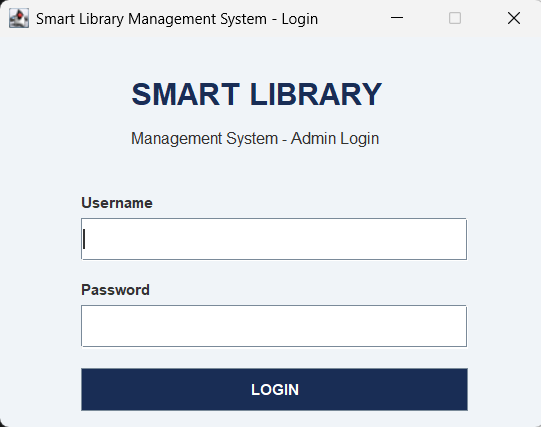
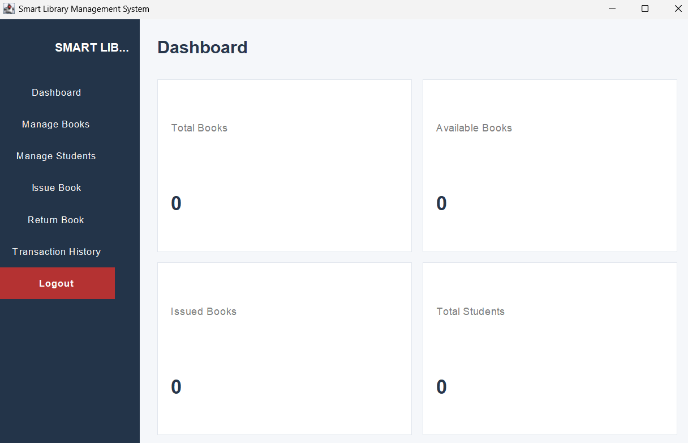
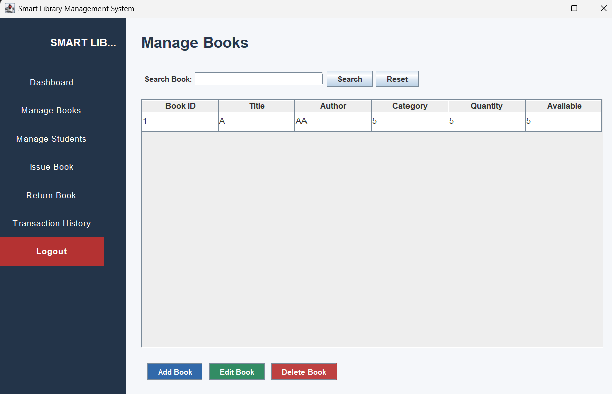
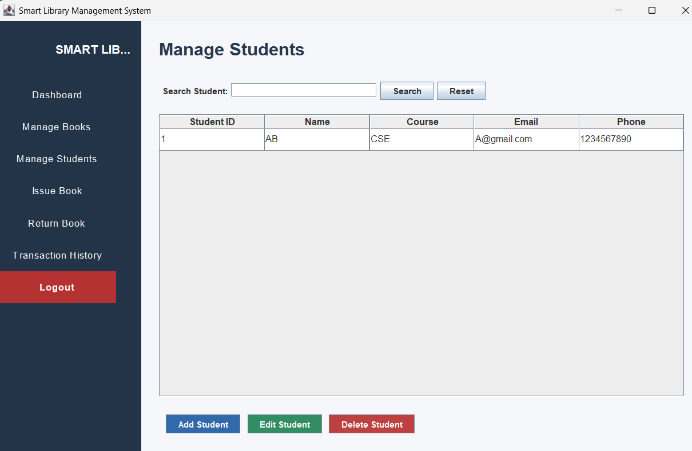
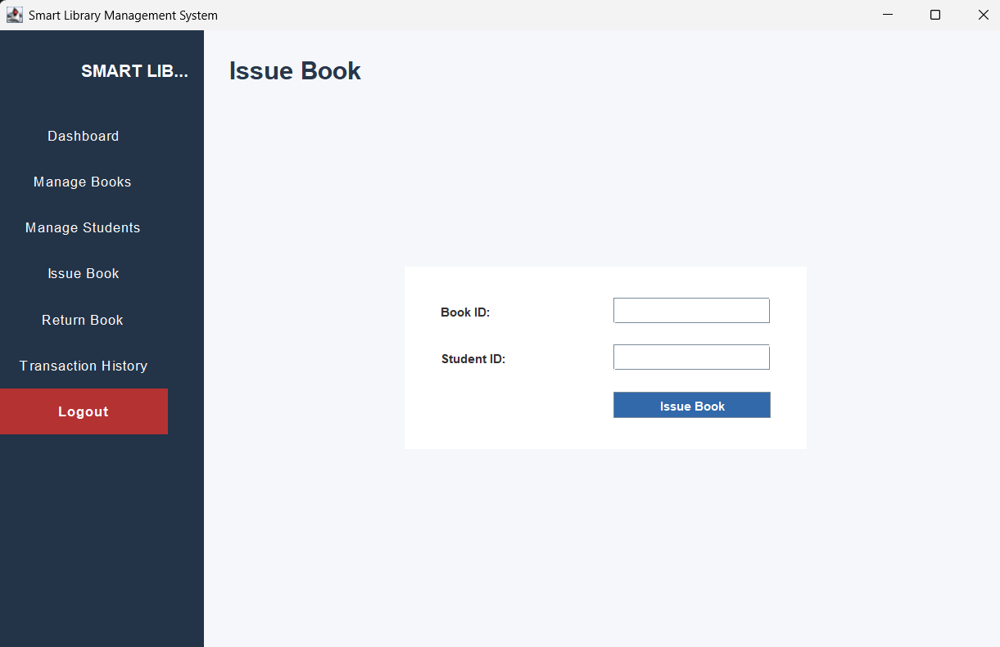
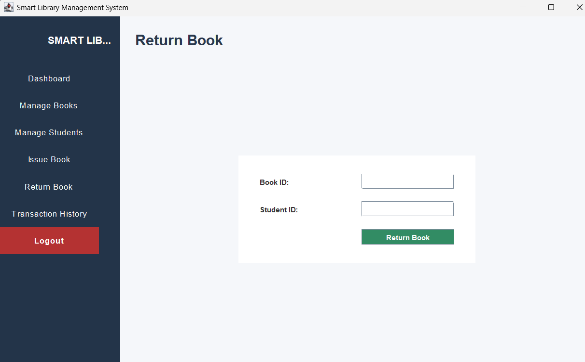
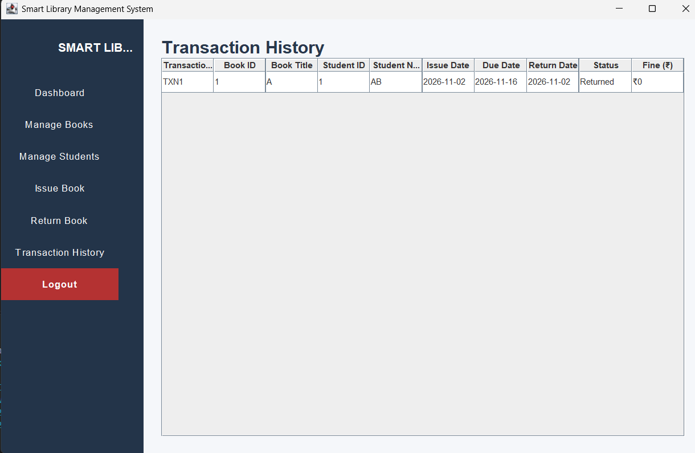

# Smart Library Management System

A desktop-based Library Management System developed using **Java Swing**. This application helps manage books, students, book issuing, returns, and transaction records through a graphical user interface.

## Features

- **Admin Login:** Login and logout functionality.
- **Dashboard:** Overview of library operations.
- **Book Management:** Add, edit, delete, and search books.
- **Student Management:** Add, edit, delete, and search student records.
- **Issue Books:** Issue books to registered students.
- **Return Books:** Manage book returns and update availability.
- **Transaction History:** View issue dates, due dates, return dates, and transaction status.
- **Fine Calculation:** Calculates overdue fines at ₹5 per day.
- **File Handling:** Saves and loads records using Java Object Serialization.
- **Data Persistence:** Preserves library records after closing and reopening the application.

## Technologies Used

- Java
- Java Swing
- Java AWT
- Object-Oriented Programming (OOP)
- ArrayList
- File Handling
- Object Serialization

## Project Structure

```text
SmartLibraryManagement/
│
└── src/
    ├── Main.java
    ├── Login.java
    ├── Book.java
    ├── Student.java
    ├── LibraryManager.java
    └── Transaction.java
```

## How to Run the Project

1. Install Java JDK on your computer.
2. Clone or download this repository.
3. Open the project in Visual Studio Code.
4. Open the `src` folder.
5. Run `Login.java`.
6. Enter the administrator credentials.

### Demo Login Credentials

- **Username:** admin
- **Password:** admin123

> Note: These are demonstration credentials. The current login uses hardcoded credentials and is not intended for production security.

## Data Storage

The application uses Java Object Serialization to store books, students, and transaction records in a local file named `library_data.dat`.

No external database is required.

## Future Improvements

- Enhanced user interface.
- Improved authentication and security.
- Database integration.
- Report generation and export functionality.

## Author

Developed as a Java project using Object-Oriented Programming concepts.

## Application Screenshots

### Admin Login


### Dashboard


### Manage Books


### Manage Students


### Issue Book


### Return Book


### Transaction History

